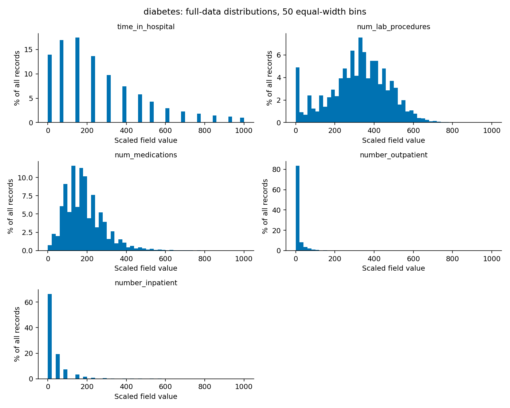
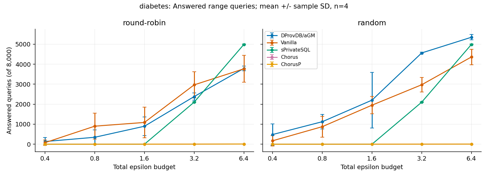
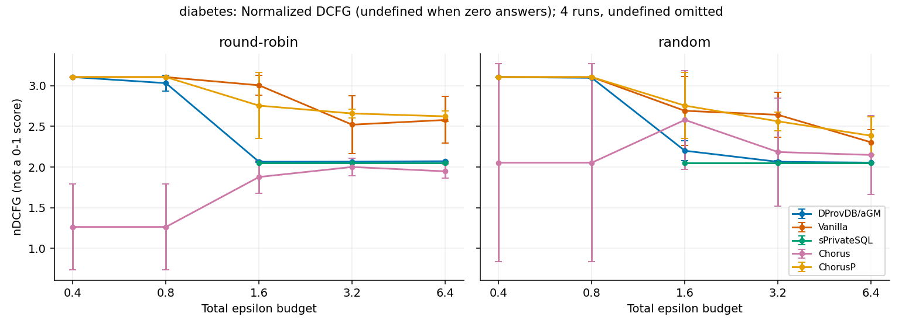
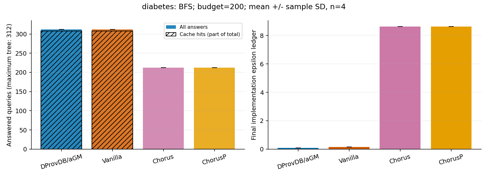

# 糖尿病住院记录：就诊级隐私与医疗数据分布

本组实际完成 **101,766 条全量记录、216 条正式配置记录**：范围查询 200 条（5 方法 × 5 预算 × 2 调度 × 4 轮），探索查询 16 条（4 方法 × 4 轮）。每条 RRQ 配置向两个分析者各提供 4,000 个请求；配置记录数不等于回答数。所有四轮和唯一键检查通过，详见 [validation.json](validation.json)。这是 SIGMOD 2024 论文 *DProvDB: Differentially Private Query Processing with Multi-Analyst Provenance* 的额外数据集扩展验证。

## 1. 数据与选择理由

Diabetes 130-US Hospitals 汇集 1999–2008 年 130 家美国医院的糖尿病相关住院记录。住院时长、检查和用药数量具有清晰计数语义，适合模拟不同医疗分析人员共享统计。

使用官方 diabetic_data.csv 的全部 101,766 次就诊。选住院天数、化验次数、用药数量、既往门诊次数和既往住院次数。encounter_id、patient_nbr 不进入查询；年龄是区间类别，不把它转换成连续年龄。 官方说明：[UCI 数据集页面](https://archive.ics.uci.edu/dataset/296/diabetes+130-us+hospitals+for+years+1999-2008)；本次具体下载：[官方数据文件](https://archive.ics.uci.edu/static/public/296/diabetes+130-us+hospitals+for+years+1999-2008.zip)。版本由文件成员名、完整行列数和 SHA-256 共同标识，详见 [manifest.json](manifest.json)。

这是就诊记录级实验，明确不是患者级差分隐私。同一患者可能多次入院；如果需要患者级保护，必须限制每位患者的贡献次数并重新计算敏感度。

## 2. 预处理与全量分布

原始文件 **101,766 行、50 列**；处理后仍为 **101,766 行、5 列**。选定的五列均无缺失值，不做填补，不删除任何行。未选中字段的缺失或类别标记不影响本任务。 原始文件有 71,518 个不同 patient_nbr，保留其全部 101,766 次就诊；`?` 等缺失计数详见 manifest 的 raw_missing_counts。

| 原始字段 | 实验字段 | 原始最小值 | 原始最大值 |
| --- | --- | ---: | ---: |
| time_in_hospital | time_in_hospital | 1 | 14 |
| num_lab_procedures | num_lab_procedures | 1 | 132 |
| num_medications | num_medications | 1 | 81 |
| number_outpatient | number_outpatient | 0 | 42 |
| number_inpatient | number_inpatient | 0 | 21 |

原始文件保留在本地 `.runtime/five-datasets/diabetes/`，处理文件另存为 `processed.csv`，不将大体积公开原始数据提交 GitHub。每列按 `z = 1000 × (x − min) / (max − min)` 缩放至 `[0,1000]`，保留 12 位有效数字，不取整、不抽样、不截断。边界来自公开基准，若换成私人数据，边界估计也需要隐私设计。原生成器会对值域做整数转换，统一非退化值域保证小数比例等字段可运行。



分布图来自数据库实际生成的 5×50 桶计数，逐列求和均为 101,766。以 BFS 字段“化验次数”为例，最密集的 20 单位缩放区间对应原始约 **42.9–45.5**，占全部记录 **7.54%**。第五字段 `number_inpatient` 的最大单桶占比为 **66.46%**，提示等宽分桶下部分区间聚集、其他区间稀疏。缩放只改变坐标，没有把长尾或集中分布变均匀。

## 3. 方法、参数和运行

两位分析者权限为 1:4；机制为 DProvDB/aGM、Vanilla（baseline）、sPrivateSQL（PrivateSQL）、Chorus、ChorusP。aGM 使用 dynamic/fixed-aGM（个人额度 ε/4、ε），Vanilla 使用 dynamic/fixed-normalized；RRQ 其余三种使用 static/fixed-normalized。BFS 不运行 sPrivateSQL，其余三种基线使用 dynamic/fixed-normalized，沿用原探索配置。

- **RRQ**：ε∈{0.4,0.8,1.6,3.2,6.4}；round-robin 与 random；每人 4,000 条；请求方差上限 `max(3000−查询索引,1)`。这是沿用原端到端实验的绝对 COUNT 方差要求，不是相对误差保证。五字段抽样权重为 1:10:1:1:1，第二字段更频繁。
- **BFS**：字段 `num_lab_procedures`，ε=200，5 叉树，粒度 2，最多每人 156、两人 312 个候选；以带噪回答大于 **1017.66（N 的 1%）** 决定继续探索。粒度与阈值是针对新值域和规模的明确适配，没有减少配置数。请求方差在 DFS 赋值顺序下为 24,900 至 9,400，执行顺序是 BFS。
- 两项均为 basic composition；每次 delta=1e-9，总 delta=1e-5。本组 1e-5 大于 1/N，应视为保留实现默认值的限制。
- 四轮工作负载种子为 1025、2050、3075、4100；每方法每轮新建机制。噪声沿用上游未统一固定种子的发生器，不能保证重跑逐位相同；BFS 的树 ID 使用原固定生成流程，四轮不代表四棵随机几何树。

从仓库根目录运行（先按顶层 README 准备一次镜像、数据库和编译产物）：

```bash
python3 extensions/five-datasets/shared/prepare_data.py --dataset diabetes
python3 extensions/five-datasets/shared/load_data.py diabetes # 只用于尚不存在的新数据库
bash extensions/five-datasets/shared/run_one.sh diabetes .runtime/five-datasets/diabetes-new-smoke smoke
bash extensions/five-datasets/shared/run_one.sh diabetes .runtime/five-datasets/diabetes-new-formal formal
```

输出目录必须不存在，载入脚本拒绝替换已有数据库。正式批次使用冻结代码，最多两进程并行，每进程 2 CPU / 2 GiB、Java 堆 1200 MiB；共享专用 PostgreSQL。此并发计时不可当成严格硬件性能对比。源码版本、参数与 SHA-256 见 [experiment.json](../shared/experiment.json)，实际运行时间见 [日志](logs/)。

## 4. 实测统计

以下为四轮均值和样本标准差（SD，非置信区间）。nDCFG 仅聚合非零效用的轮次，其有效 count 见 summary.csv；全为零回答则保持未定义。重复一致时 SD=0；不会为了制造差异加入扰动。

### 范围查询

| 方法 | ε=0.4 | ε=0.8 | ε=1.6 | ε=3.2 | ε=6.4 |
| --- | --- | --- | --- | --- | --- |
| DProvDB/aGM | 134.50 ± 198.78 | 346.75 ± 362.70 | 898.00 ± 460.39 | 2381.50 ± 176.65 | 3787.50 ± 123.97 |
| Vanilla | 77.50 ± 129.86 | 901.50 ± 648.54 | 1088.50 ± 769.79 | 2966.50 ± 660.86 | 3767.75 ± 667.99 |
| sPrivateSQL | 0.00 ± 0.00 | 0.00 ± 0.00 | 0.50 ± 1.00 | 2101.00 ± 18.65 | 4986.50 ± 27.78 |
| Chorus | 1.25 ± 0.50 | 1.25 ± 0.50 | 2.50 ± 0.58 | 4.75 ± 0.96 | 9.50 ± 1.29 |
| ChorusP | 0.50 ± 0.58 | 1.00 ± 0.00 | 2.75 ± 0.50 | 4.75 ± 0.50 | 9.75 ± 0.96 |



在 round-robin、ε=6.4 下，aGM 平均回答 **3787.50** 条，Vanilla 为 **3767.75** 条；aGM 的缓存状态命中平均 **3712.25** 条，占其回答的 **98.01%**。切换到 random 后，aGM 平均回答 **5345.50** 条。这里的“缓存命中”来自执行状态计数，不保证零计算成本，aGM 缓存路径仍可能进行额外计算。



`nDCFG = (u_low / log2(2) + u_high / log2(1.25)) / (u_low + u_high)`。它除以总回答数，**不是 0–1 分数**，本配置非零效用时约落在 [1,3.1063]。本组有 **26** 条配置零回答，其 nDCFG 和已回答请求方差均为空值，未当成 0 或正常公平性分数。该指标更偏重高权限分析者，不能直接解释为平等程度。

### 探索查询

| 方法 | 已回答数，均值 ± SD | 缓存命中均值 | 最终 ε 账本均值 | nDCFG 均值 |
| --- | --- | --- | --- | --- |
| Chorus | 212.00 ± 0.00 | 0.00 | 8.62 | 2.05 |
| ChorusP | 212.00 ± 0.00 | 0.00 | 8.62 | 2.05 |
| DProvDB/aGM | 312.00 ± 0.00 | 308.00 | 0.09 | 2.05 |
| Vanilla | 312.00 ± 0.00 | 308.00 | 0.15 | 2.05 |



BFS 候选总数最多 312，实际回答范围为 **212–312**。提前停止会受分布、阈值、噪声及既有实现行为共同影响。预建本组五视图实际耗时 **2.464 秒**，每进程只初始化一次；CSV 中重复记录该值，不能把它按 216 行相加。完整分调度、分预算统计见 [summary.csv](summary.csv)。

## 5. 本组观察与不符合预期的结果

aGM 并非在所有设置都领先：round-robin、ε=6.4 时，sPrivateSQL 平均回答 **4986.50** 条，对比 aGM 的 **3787.50** 条。调度切换也会改变排名，说明静态视图预分配在本次统一查询结构下并非必然劣势；不能只挑出 aGM 最好的设置写结论。

本组数据的集中度可由分布图直接检查，但统一的五字段、值域、桶数、精度和种子使五组 RRQ 的接收数与账本呈相同结果。这反映原程序的接收决策主要取决于查询结构和预算，而不是数据值。我们保存每组各自运行的结果与日志，没有把其他组数字复制过来。

BFS 对带噪回答作分支决策，比 RRQ 更容易体现分布差异。不过原直方图桶顺序、查询范围与敏感度问题会影响这类解释，不能将方法间回答差异直接归因为更好的真实区间发现。预算为 200 时账本远低于上限并不奇怪：缓存复用和阈值剪枝都可能提前减少新发布。

另一个与直觉不符的结果是：aGM 本组有 **31** 条配置的低权限分析者最终账本超过其实际个人额度 ε/4。aGM 按最高权限归一化，个人额度分别为 ε/4 和 ε；其缓存状态可早于个人约束检查返回。全局账本在上限内不能证明个人约束全部满足。

## 6. 对“大数据”课程的启发

医疗数据中的“一个人”和“一条记录”并不等价。分布式汇总、缓存和预算会计都依赖一致的贡献单位；仅把 ID 删除并不能得到患者级保护。未使用字段的缺失不应导致无理由删除完整就诊记录，预处理策略必须与分析任务相匹配。

查询处理的吞吐、近似结构的分辨率、请求精度、实际答案误差和隐私预算是不同维度。本次同时保留原始结果、分布、账本和缓存计数，体现了大数据实验应如何区分这些维度；单看“回答更多”容易遗漏正确性与公平性问题。

## 7. 限制、验证和复现材料

本实验沿用原实现，没有重写机制公式，也不声称修复原 [source-audit.md](../../../reproduction/source-audit.md) 中的问题。Chorus/ChorusP 实际使用 Laplace 噪声但以 Gaussian 校准预算；范围桶数可能让基线预算换算过于保守。请求方差均值来自 `_accuracyRequirement`，**没有测量实际答案 MSE**；最终 epsilon 是程序账本，不是独立隐私证明。

新增审查还发现：原视图以 Map.values 顺序存入列表、回答却用数字桶索引，存在错桶风险；BFS 没给 `_rlb/_rub` 赋值，敏感度路径返回 1，无法据此保证跨桶答案满足请求方差；BFS 严格开区间 SQL 与整桶近似不等价。缓存路径个人额度检查及 BFS 拒答空指针问题也未修复。这些限制使 BFS 结果只能代表现有程序执行行为。详见 [扩展审查](../shared/implementation-notes.md)。

验证覆盖全部 216 条唯一配置、四轮种子、200/16 配置分组、计数守恒、零效用空值、nDCFG 公式、全局账本范围、原始直方图总数及进程成功结束。它不验证真实误差、患者级贡献约束或完整 DP 证明。

- [原始正式结果](raw/results.csv)、[真实直方图计数](raw/histograms.csv)、[统计汇总](summary.csv)
- [数据处理清单与校验值](manifest.json)、[验证结果](validation.json)、[运行日志与时间](logs/)
- [独立公共脚本和冻结参数](../shared/)、[本扩展导航](../README.md)

本组没有未完成的正式配置；未增加组件消融，未重跑 Adult/TPC-H。原始公开数据按官方来源重新下载，处理后 SHA-256 可与清单核对。
